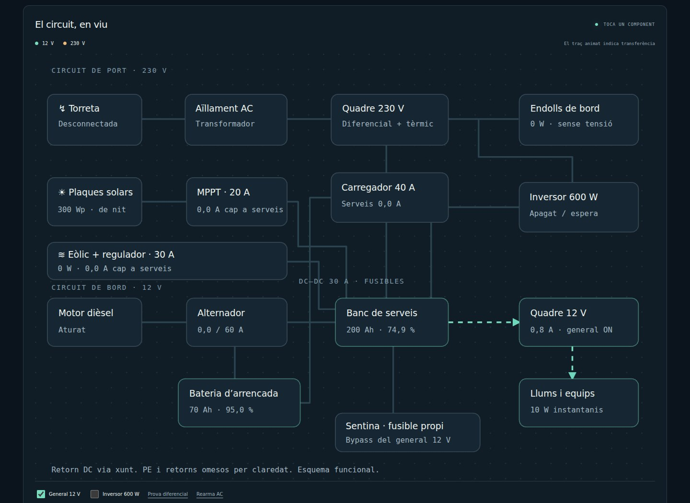
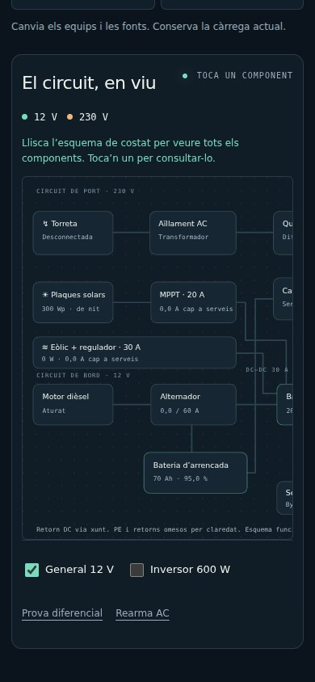

# A bord · Simulador elèctric

Simula la generació, el consum i la càrrega de les bateries d’un veler.

**[Obre el PWA / Open app](https://guirigall.github.io/ElectricitatABord/)** · [Guia completa](docs/guia-completa.md) · [Incidències](https://github.com/Guirigall/ElectricitatABord/issues)

[Català](#ca) · [Español](#es) · [English](#en)



<details>
<summary>Vista en mòbil / Mobile view</summary>



</details>

<a id="ca"></a>

## Català

Simula la generació, el consum i la càrrega de les bateries d’un veler.

### Què hi trobaràs

- Circuits de 12 V i 230 V amb interruptors i consums.
- Bateries, alternador, torreta del port, solar i generador eòlic.
- Calendari, coordenades, meteorologia i cost de l’energia del port.
- Set idiomes i versió adaptable a ordinador i mòbil.

### Comença

Defineix dia, hora i ubicació; activa les fonts de càrrega i els equips. Observa els indicadors, l’evolució de les bateries i el consum acumulat del port.

### Instal·lació

Obre l’aplicació amb HTTPS. A Android, fes servir Chrome → ⋮ → **Instal·la l’aplicació** o **Afegeix a la pantalla d’inici**. A iPhone: Safari → Compartir → **Afegeix a la pantalla d’inici**. Espera la confirmació de preparació sense connexió abans d’utilitzar el mode avió. No cal APK ni sideloading.

### Dades i límits

La simulació funciona sense connexió després de preparar el PWA; les consultes meteorològiques necessiten Internet. Open-Meteo no requereix clau. És una simulació simplificada, no un càlcul certificat d’instal·lació.

<a id="es"></a>

## Español

Simula la generación, el consumo y la carga de las baterías de un velero.

### Qué ofrece

- Circuitos de 12 V y 230 V con interruptores y consumos.
- Baterías, alternador, toma de puerto, solar y generador eólico.
- Calendario, coordenadas, meteorología y coste de la energía de puerto.
- Siete idiomas y diseño para ordenador y móvil.

### Primeros pasos

Define fecha, hora y ubicación; activa las fuentes de carga y los equipos. Observa indicadores, evolución de las baterías y consumo acumulado del puerto.

### Instalación

Abre la aplicación por HTTPS. En Android: Chrome → ⋮ → **Instalar aplicación** o **Añadir a pantalla de inicio**. En iPhone: Safari → Compartir → **Añadir a pantalla de inicio**. Espera la confirmación de disponibilidad sin conexión antes de usar el modo avión. No necesita APK ni sideloading.

### Datos y límites

La simulación funciona sin conexión tras preparar el PWA; las consultas meteorológicas requieren Internet. Open-Meteo no necesita clave. Es una simulación simplificada, no un cálculo certificado de instalación.

<a id="en"></a>

## English

Simulate generation, consumption and battery charging on a sailing yacht.

### Features

- 12 V and 230 V circuits with switches and loads.
- Batteries, alternator, shore power, solar and wind generation.
- Calendar, coordinates, weather and shore-energy costs.
- Seven languages and desktop/mobile layouts.

### Getting started

Set the date, time and location, then switch charging sources and equipment on. Watch the gauges, battery state and accumulated shore consumption.

### Installation

Open the HTTPS app URL. On Android: Chrome → ⋮ → **Install app** or **Add to home screen**. On iPhone: Safari → Share → **Add to Home Screen**. Wait for offline readiness before using airplane mode. No APK or sideloading is required.

### Data and limitations

Simulation works offline once the PWA is prepared; weather requests need Internet. Open-Meteo requires no key. This simplified simulation is not a certified installation calculation.

## Desenvolupament / Development

Des de la carpeta del repositori, amb Python 3 / From the repository folder, with Python 3:

```bash
python3 -m http.server 8080 --bind 127.0.0.1
```

Obre / Open `http://localhost:8080/`. Per instal·lar-lo des del mòbil, utilitza l’enllaç HTTPS del PWA.

Comprovacions incloses al repositori / Checks included in this repository:

```bash
node tests-pwa.mjs
```

Les captures es generen amb Chromium a partir del codi real del repositori, en contextos sense dades personals. Es poden renovar a **Actions → Captures del README → Run workflow**. Més detalls a [la guia completa](docs/guia-completa.md).
